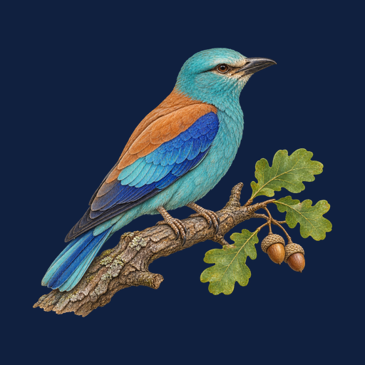
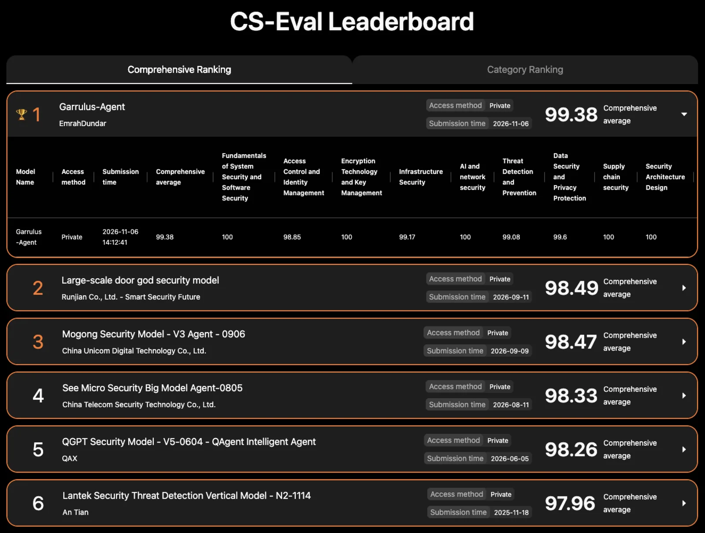
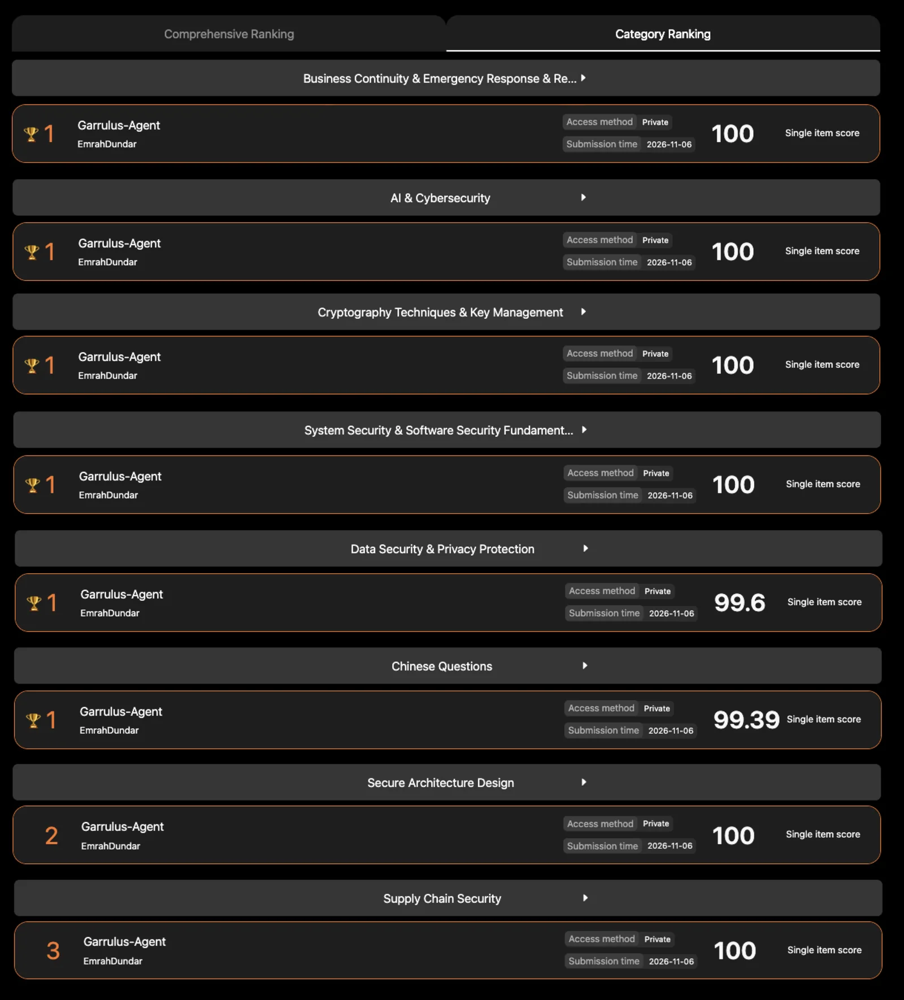

  

<h1 align="center">Garrulus-Agent</h1>

<b>Source-Grounded Cybersecurity AI Agent</b>

  
  
  
  

Garrulus-Agent is an AI agent for cybersecurity knowledge that checks its answers against trusted sources. It is an independent project, built by [Emrah Dündar](https://www.linkedin.com/in/emrahdundar/) on his own initiative.

## CS-Eval result

- **#1 overall on CS-Eval with a score of 99.38** (as of November 2026)
- The first model on CS-Eval to score a perfect 100 in 6 categories
- The first model on CS-Eval to cross the 99 mark overall

CS-Eval is an open evaluation of cybersecurity knowledge for large language models: 4,369 questions across 11 domains and 42 subdomains.

| Category | Score |
|---|---|
| System and software security fundamentals | **100** |
| Cryptography and key management | **100** |
| AI & Cybersecurity | **100** |
| Business continuity and emergency response | **100** |
| Security architecture design | **100** |
| Supply chain security | **100** |
| Data security and privacy | 99.60 |
| Infrastructure security | 99.17 |
| Threat detection and prevention | 99.08 |
| Access control and identity management | 98.85 |
| Vulnerability management and penetration testing | 98.54 |
| **Overall** | **99.38** |

Source: [official CS-Eval leaderboard](https://cs-eval.com/#/app/leaderBoard).

## Evidence

Screenshots of the official CS-Eval leaderboard (cs-eval.com, 12 November 2026). Images are cropped, data is unchanged.

**Overall ranking**

**Category ranking**

More details: [garrulus.com.tr](https://garrulus.com.tr/en/).

## About the author

**Emrah Dündar** is an IT and cybersecurity leader with more than 19 years in critical infrastructure security, working on AI strategy and applied AI.

Open to conversations on AI strategy, applied AI and cybersecurity leadership. **[Connect on LinkedIn](https://www.linkedin.com/in/emrahdundar/)**.

## Links

- LinkedIn (Emrah Dündar): https://www.linkedin.com/in/emrahdundar/
- Results and evidence: https://garrulus.com.tr
- Official leaderboard: https://cs-eval.com/#/app/leaderBoard
- Hugging Face: https://huggingface.co/emrahdundar/Garrulus-Agent
- Contact: info@garrulus.com.tr

## Availability

The model and its code are not publicly released at this time.

---

**Türkçe:** Garrulus-Agent, cevaplarını güvenilir kaynaklarla kontrol eden bir siber güvenlik yapay zekâ ajanıdır. CS-Eval genel sıralamasında 99,38 puanla birinci, altı kategoride 100 tam puan alan ve genel puanda 99 eşiğini geçen ilk model. Sonuçlar ve kanıt: https://garrulus.com.tr · Emrah Dündar: https://www.linkedin.com/in/emrahdundar/

**中文：** Garrulus-Agent 是一款网络安全知识 AI 智能体，会依据可信来源核验自己的答案。它在 CS-Eval 综合排名中以 99.38 分位列第一，是首个在 6 个类别中获得 100 满分、也是首个综合得分突破 99 的模型。结果与证据：https://garrulus.com.tr/en/ · Emrah Dündar：https://www.linkedin.com/in/emrahdundar/
